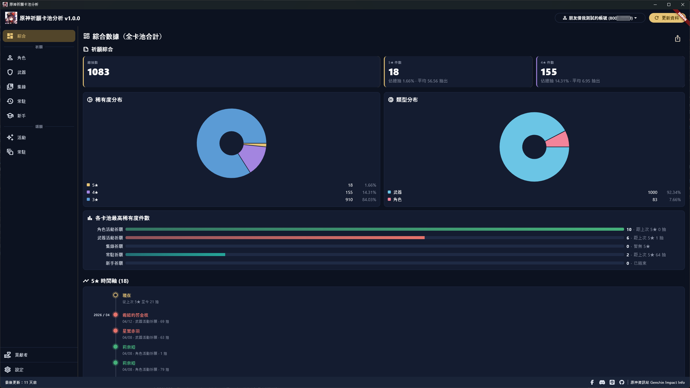
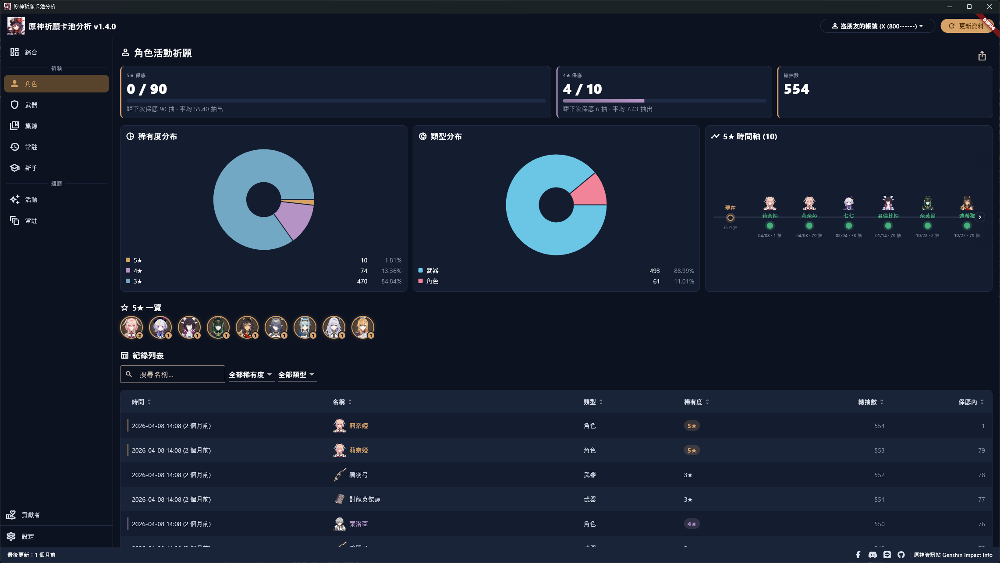
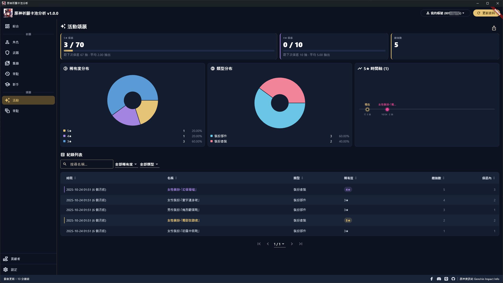
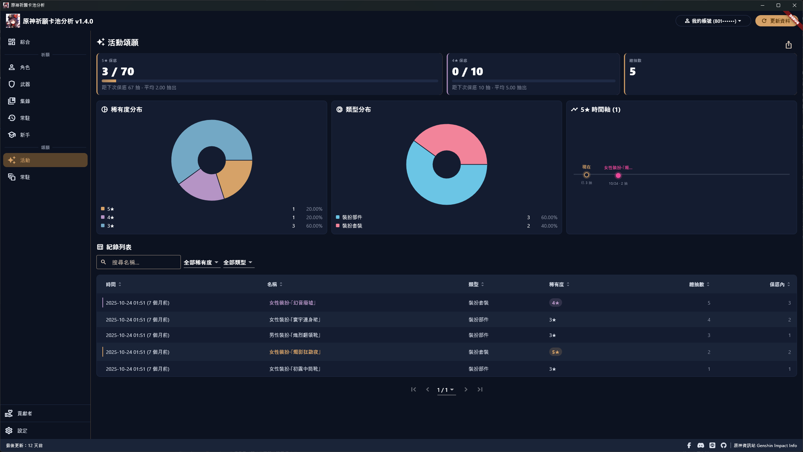
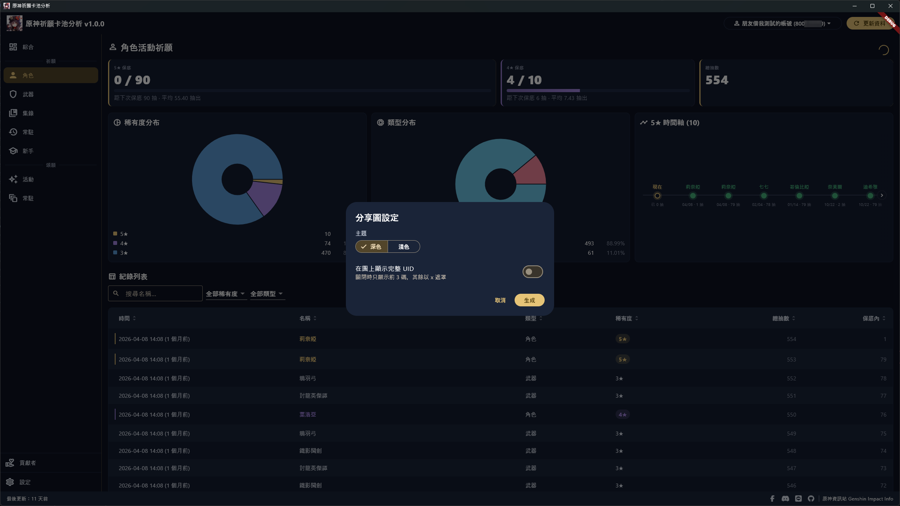
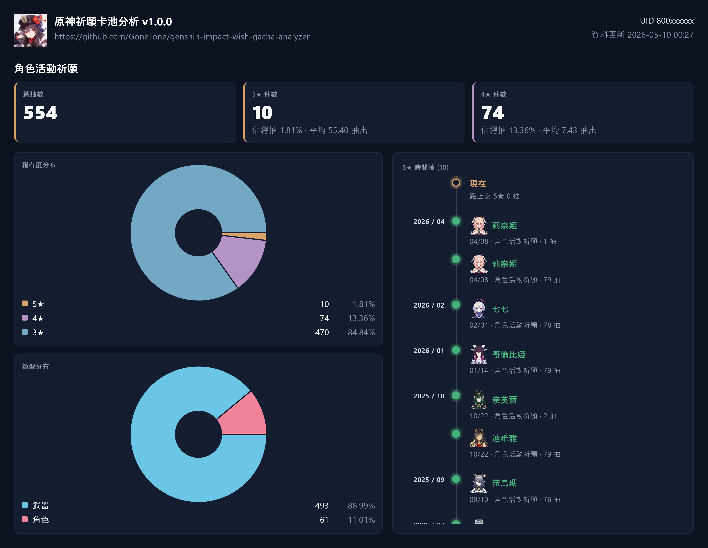
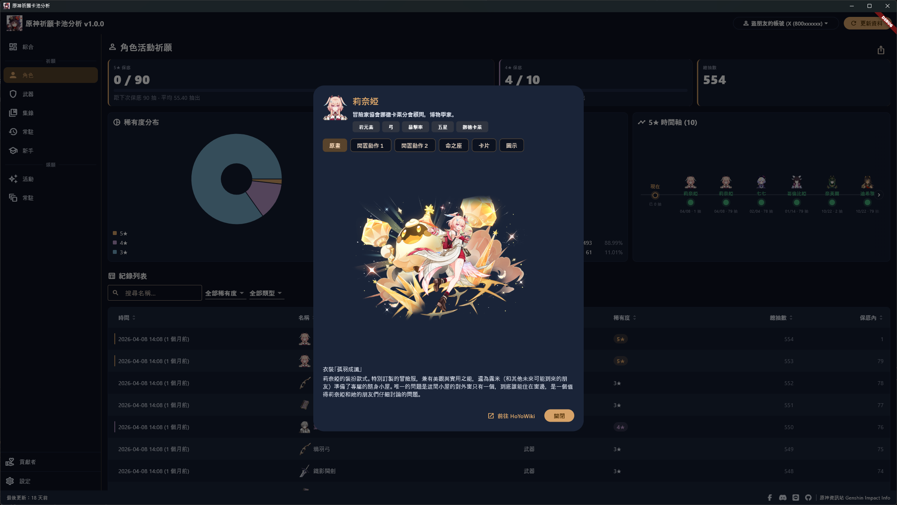

# 原神祈願卡池分析 Genshin Impact Wish Gacha Analyzer

繁體中文 | [简体中文](README_ZH-HANS.md) | [English](README_EN.md) | [日本語](README_JA-JP.md)

[](https://crowdin.com/project/genshin-impact-wish-gacha-analyzer)

一套用來分析祈願卡池歷史記錄的軟體，支援 Windows 與 Android，一開啟各種數據清清楚楚，不用再手動計算啦！

Windows 版的原理是按下「更新資料」後會在本機啟動一個只跑在您電腦上的代理伺服器，並自動安裝一張本機產生的根憑證，藉此攔截原神 WebView 對 miHoYo 卡池歷史 API 的請求，所以要在按下更新後再到遊戲內開啟卡池歷史記錄才能攔到，取得網址後拆解參數，參數會用於 miHoYo 原神相關的 API。

Android 版不攔截連線，改為讀取系統 log，從中找出原神開啟卡池歷史頁面時留下的網址。Android 不允許 App 直接讀取其他 App 的系統 log，所以會依裝置狀況使用 root 或系統內建的「無線偵錯」（Android 11 以上）來讀取，兩種都無法使用時可以改用手動輸入祈願記錄網址。使用無線偵錯時讀完就會中斷連線，如果無線偵錯是本 App 打開的，也會一併關閉。

第一次按下「更新資料」會加載您完整的卡池歷史，這可能需要一些時間，完成後會將資料存放在您的裝置內，這樣下次開啟軟體就不用再花時間等待資料加載。之後想取得新資料按一下「更新資料」即可，軟體會記住先前取得的網址，能用就直接用、不用每次重新取得；如果網址過期，軟體會請您再到遊戲開一次卡池歷史頁面以重新取得網址。

請放心：本軟體不會竄改任何遊戲檔案，也不會讀取或竄改遊戲記憶體與遊戲傳輸的資料。Windows 版只會在 WebView 開啟卡池歷史頁面時攔下那一條請求網址，另外也會讀取遊戲的 log 與網頁快取來找出網址；Android 版只會從系統 log 讀取原神的祈願記錄網址。所以不會有被封鎖帳號的風險。如果有被封號，請思考您是不是其他原因被封鎖，不要怪罪我們。

文章：
- 巴哈姆特：<https://forum.gamer.com.tw/C.php?bsn=36730&snA=11990>
- HoYoLAB：<https://www.hoyolab.com/genshin/article/552176>
- 原神資訊站：<https://genshininfo.reh.tw/archives/97>

## 多國語言

請協助我們將軟體翻譯成各國語言！

<https://crowdin.com/project/genshin-impact-wish-gacha-analyzer>

## 下載軟體

軟體在安裝或執行時有可能會被防毒軟體阻擋。原因是本軟體會自行產生並安裝一張本機根憑證、並在按下更新時短暫設定系統代理以攔截原神 WebView 的卡池歷史請求──這類行為與惡意程式相似，但本軟體只攔截 `*.hoyoverse.com` 上的 `getGachaLog`（祈願）與 `getBeyondGachaLog`（頌願）這兩條卡池歷史 API，且憑證只留在您的電腦。如果無法正常執行，請嘗試關閉防毒軟體後再執行看看，本軟體保證無毒。

<https://github.com/GoneTone/genshin-impact-wish-gacha-analyzer/releases>

### 也有支援其他遊戲的版本

- 鳴潮：<https://github.com/GoneTone/wuthering-waves-convene-gacha-analyzer>
- 未來可能新增支援更多遊戲...

## 使用方式

### Windows

1. 啟動原神，先別開啟卡池歷史頁面。
2. 開啟本軟體並按下「更新資料」，軟體會在背景啟動本機代理伺服器並等候攔截。
3. 切回遊戲，到「祈願 → 歷史記錄」開啟卡池歷史頁面。
4. 軟體攔到網址後會自動關閉代理、還原系統代理設定並開始抓取資料；之後想再更新只要重複步驟 2，網址未過期就會直接套用。

### Android

1. 第一次按下「更新資料」時，有 root 的裝置會直接用 root 讀取；其他裝置 App 會引導你設定系統內建的「無線偵錯」，依畫面指示配對一次（需要 Android 11 以上、連上 Wi‑Fi、允許通知），之後 App 會自己開關無線偵錯（部分裝置有額外的安全性限制，可能要每次手動開啟）。
2. 按下「更新資料」後切到遊戲，到「祈願 → 歷史記錄」開啟卡池歷史頁面。
3. App 從系統 log 找到網址後，回到 App 就會自動開始抓取資料。
4. 無法自動讀取時（例如沒有 root 且是 Android 10 以下，或沒有連上 Wi‑Fi），可以改用手動輸入祈願記錄網址。

## 功能與特色

- 支援 Windows 與 Android
- 自動取得祈願記錄網址，不需手動貼網址：Windows 版攔截原神 WebView 對 miHoYo 卡池歷史 API 的請求（透過本機代理伺服器與自簽根憑證）；Android 版讀取系統 log（root 或無線偵錯）
- 支援國際服 (暫不支援中國服)
- 涵蓋 7 種卡池：角色活動祈願、武器活動祈願、集錄祈願、常駐祈願、新手祈願、活動頌願、常駐頌願
- 多帳號 (UID) 管理：自訂別名、拖曳排序、一鍵切換
- 自動合併新舊資料，不覆蓋過去記錄，不會因為官方歷史記錄過時而消失
- 總抽數及 5★ / 4★ / 3★ / 2★ 件數與占比統計
- 5★ 與 4★ 雙保底進度條，並顯示距離保底剩餘抽數
- 5★ / 4★ 平均出貨抽數統計（各卡池與整體）
- 各卡池 5★ 時間軸
- 5★ 總覽：橫向陳列抽到過的所有不重複 5★，每個附累計次數徽章、可點開詳情；各卡池頁、綜合數據頁與分享圖皆會顯示
- 各卡池最高稀有度件數比較長條圖
- 稀有度分布圓餅圖
- 類型分布圓餅圖
- 歷史記錄表格：多欄排序、關鍵字搜尋（依名稱）、稀有度與物品類型篩選、分頁
- 自動補上角色 / 武器的圖示與資料（來源：[HoYoWiki](https://wiki.hoyolab.com/pc/genshin/home)）：表格與時間軸都附圖示；點擊物品可查看官方插圖、描述與標籤，並一鍵跳轉 HoYoWiki
- 一鍵生成分享圖（可選深色 / 淺色主題、UID 全顯或只留前三碼遮罩），可複製到剪貼簿或另存為 PNG 檔，Android 版也能直接透過系統分享
- 帳號資料匯出 / 匯入 JSON
- 雲端同步：連結您自己的 Google 帳號後，卡池記錄自動備份到您的 Google 雲端硬碟，並在多台裝置間雙向同步；刪除帳號時可勾選一併從雲端移除
- 深色 / 淺色主題切換
- 多國語言（[協助翻譯](https://crowdin.com/project/genshin-impact-wish-gacha-analyzer)）
- 可在設定開啟介面 UID 遮罩（只顯示前三碼），保護隱私
- 啟動時自動檢查新版本，也可在設定頁手動觸發（Android 版透過 Google Play 更新）
- 所有資料預設留在本機、不上傳；雲端同步為選擇性功能，啟用後也只會備份到您自己的 Google 雲端硬碟
- Android 版會顯示 AdMob 原生廣告（需要同意的地區會先徵求同意）；Windows 版沒有廣告

## 截圖










## 開發

### 前置需求

- Windows 版要在 Windows 上建置；Android 版另需 [Android Studio](https://developer.android.com/studio)（Android SDK）
- [Flutter SDK](https://docs.flutter.dev/install)（最新穩定版）
- [Rust toolchain](https://rustup.rs/)（stable）
- 執行 `flutter doctor`，依提示補齊缺少的工具

### 取得原始碼並安裝依賴

```bash
git clone https://github.com/GoneTone/genshin-impact-wish-gacha-analyzer.git
cd genshin-impact-wish-gacha-analyzer
flutter pub get
```

Rust 會在 `flutter run` / `flutter build` 時由 `rust_builder/` 的 cargokit 自動編譯，不需手動 `cargo build`（但需先安裝 Rust toolchain）。

### 開發模式執行

```bash
flutter run -d windows        # Windows
flutter run -d <device id>    # Android 實機或模擬器（ID 用 flutter devices 查）
```

### 雲端同步憑證（選用）

雲端同步（Google 雲端硬碟備份）需要 Google OAuth 憑證。未設定時其他功能完全不受影響，僅設定頁的雲端同步區塊顯示未設定提示。

要在自己的建置啟用：

1. 到 [Google Cloud Console](https://console.cloud.google.com/) 建立專案，啟用 **Google Drive API**，設定 OAuth 同意畫面（scopes：`.../auth/drive.appdata` 與 `email`），建立「**電腦版應用程式**」類型的 OAuth 用戶端。
2. 在專案根目錄建立 `secrets/cloud_sync_defines.json`（已被 git 忽略）：

   ```json
   {
     "CLOUD_SYNC_CLIENT_ID": "你的 client id",
     "CLOUD_SYNC_CLIENT_SECRET": "你的 client secret"
   }
   ```

3. 執行時帶入該檔（JetBrains IDE 可直接選內建的「main.dart (cloud sync + ads)」執行設定（會一併帶入下方的 `secrets/ads_defines.json`，兩個檔都要存在）；`build_release.ps1` 打包時會自動偵測）：

   ```bash
   flutter run -d windows --dart-define-from-file=secrets/cloud_sync_defines.json
   ```

4. Android 沿用同一個 `secrets/cloud_sync_defines.json`，但要在**同一個** Google Cloud 專案再建立一個「**Android**」類型的 OAuth 用戶端：套件名稱填 `tw.reh.genshin.gacha`，SHA-1 填簽署 APK 那把金鑰的指紋（開發用 debug 金鑰可用 `keytool -list -v -keystore ~/.android/debug.keystore -alias androiddebugkey -storepass android` 查）。這個用戶端的 ID 不需要放進設定檔，Google 會用套件名稱和簽章比對。必須和電腦版用戶端在同一個專案，兩邊才會讀寫同一份同步檔。

   ```bash
   flutter run -d <裝置 ID> --dart-define-from-file=secrets/cloud_sync_defines.json
   ```

### 廣告 ID（選用，Android）

Android 原生廣告的 AdMob ID 同樣在建置時注入，不寫進原始碼。要在自己的建置播正式廣告，在專案根目錄建立 `secrets/ads_defines.json`（已被 git 忽略），並和雲端同步設定檔一起帶入：

```json
{
  "ADMOB_APP_ID": "ca-app-pub-xxxxxxxxxxxxxxxx~yyyyyyyyyy",
  "ADMOB_NATIVE_UNIT_ID": "ca-app-pub-xxxxxxxxxxxxxxxx/wwwwwwwwww"
}
```

```bash
flutter run -d <device id> --dart-define-from-file=secrets/cloud_sync_defines.json --dart-define-from-file=secrets/ads_defines.json
```

沒有這個檔案、或非 release 建置時，一律使用 Google 官方測試廣告 ID，只會顯示測試廣告。


### Rust ↔ Dart 橋接程式碼產生

修改 `rust/src/api/` 內的 Rust 函式後，重新產生橋接程式碼。第一次使用前先安裝 codegen 工具：

```bash
cargo install flutter_rust_bridge_codegen --version 2.12.0
```

之後每次修改 API 都執行：

```bash
flutter_rust_bridge_codegen generate
```

產生的檔案位於 `lib/src/rust/`。

### 編譯生產版

Windows：

```bash
flutter build windows --release
```

輸出：`build\windows\x64\runner\Release\`

Android：

```bash
flutter build apk --release        # 直接安裝用的 APK
flutter build appbundle --release  # 上傳 Google Play 用的 AAB
```

輸出：`build/app/outputs/flutter-apk/app-release.apk`、`build/app/outputs/bundle/release/app-release.aab`

要用自己的金鑰簽署，在 `android/key.properties`（已被 git 忽略）填入 `storeFile`、`storePassword`、`keyAlias`、`keyPassword`；沒有這個檔案時會用 debug 金鑰簽署。

### 執行測試

```bash
flutter test
cargo test --manifest-path rust/Cargo.toml
```
