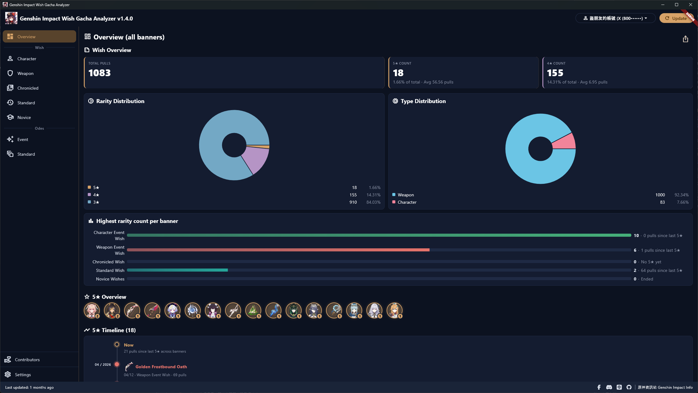
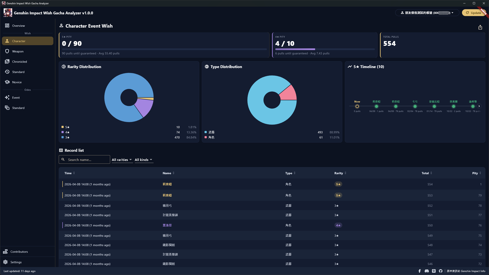
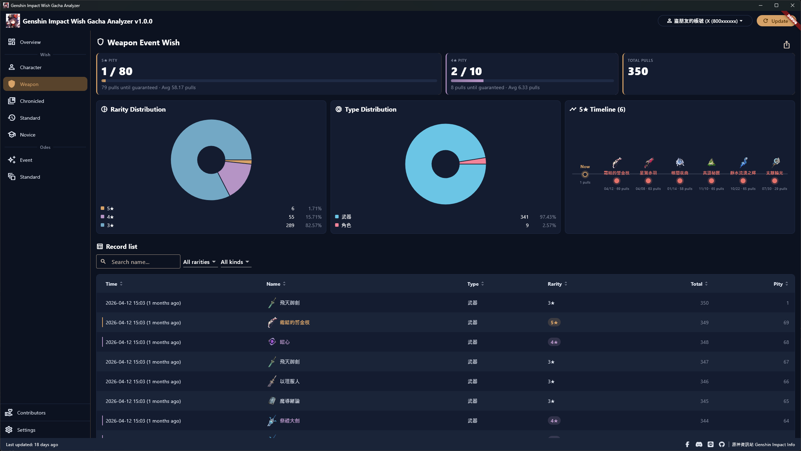
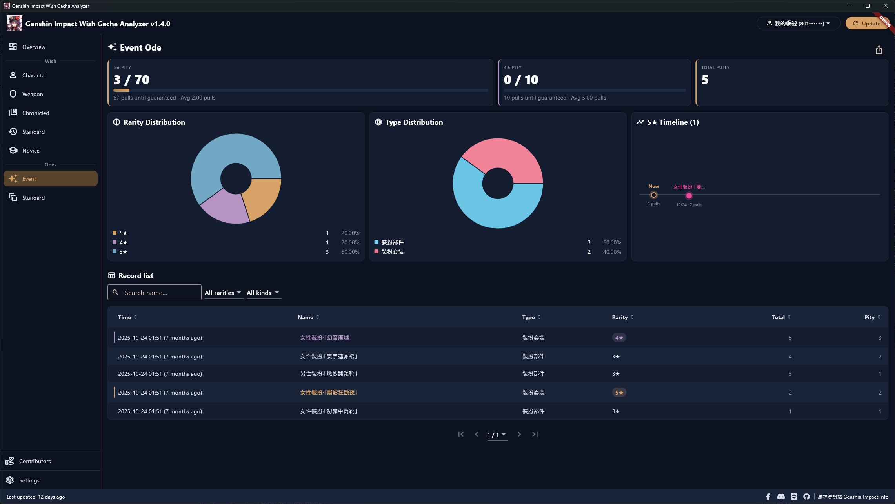
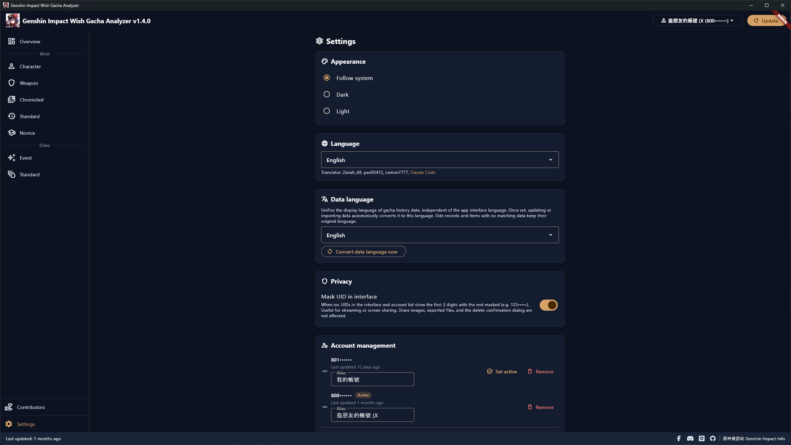
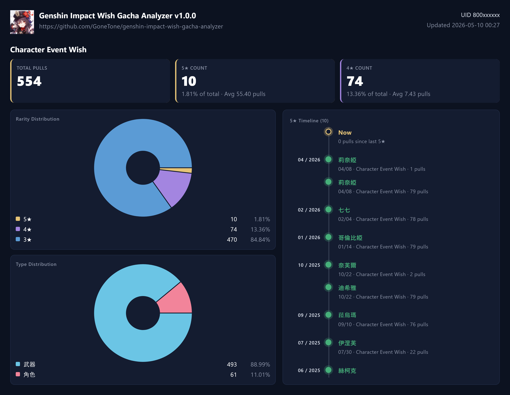
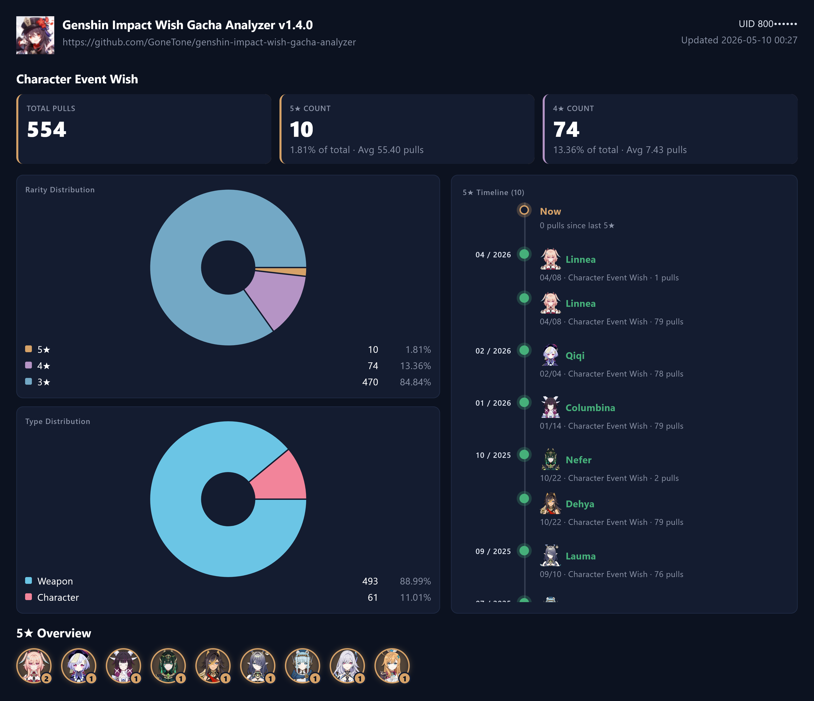
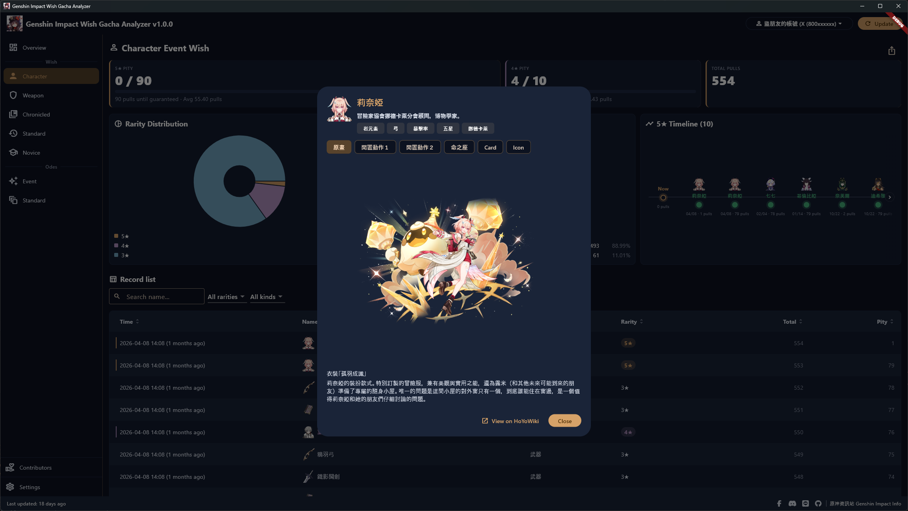

# 原神祈願卡池分析 Genshin Impact Wish Gacha Analyzer

[繁體中文](README.md) | [简体中文](README_ZH-HANS.md) | English | [日本語](README_JA-JP.md)

[](https://crowdin.com/project/genshin-impact-wish-gacha-analyzer)

A wish history analyzer for Windows and Android, with all data and numbers well-organized in a convenient manner.

On Windows, when you press *Update*, the utility starts a local proxy server (running only on your computer) and automatically installs a locally generated root certificate, so it can intercept Genshin Impact's WebView request to the miHoYo wish history API. You therefore need to open the wish history page in the game *after* pressing *Update*, so the request can be captured. The captured URL is parsed and the resulting parameters are used to call miHoYo's API.

The Android version doesn't intercept network traffic; instead it reads the system log and finds the URL that Genshin Impact leaves there when it opens the wish history page. Android doesn't let apps read other apps' system logs directly, so depending on the device it reads the log via root or the system's built-in *Wireless debugging* (Android 11 or later); if neither is available, you can enter the Wish History URL manually. When using Wireless debugging, it disconnects as soon as it's done reading, and if the app turned Wireless debugging on, it turns it back off.

The first time you press *Update*, the utility loads your full gacha history, which may take a while. The data is then stored locally so you don't have to wait again on the next launch. To pull new records, just press *Update*: the utility remembers the previously obtained URL and reuses it as long as it's still valid, so you don't have to obtain it again every time. If the URL has expired, the utility will ask you to open the wish history page in the game again to get a new one.

Rest assured: this utility does not modify any game file, and does not read or modify game memory or in-game network traffic. On Windows it only intercepts the wish history page request that the in-game WebView itself makes, and also reads the game's log and web cache to find the URL; on Android it only reads Genshin Impact's Wish History URL from the system log. So there is no risk of being banned for using it. If you have been banned, it was likely for a different reason. Please do not blame us, thanks.

Posts:
- 巴哈姆特 (Bahamut): <https://forum.gamer.com.tw/C.php?bsn=36730&snA=11990>
- HoYoLAB: <https://www.hoyolab.com/genshin/article/552176>
- 原神資訊站 (Genshin Impact Info): <https://genshininfo.reh.tw/archives/97>
 
## Multiple Language
 
Please help us translate this software.
 
<https://crowdin.com/project/genshin-impact-wish-gacha-analyzer>
 
## Download Software
 
The utility may trigger anti-virus software during installation and execution. This is because it generates and installs a local root certificate, and briefly configures a system proxy when you press *Update* to intercept the in-game WebView's wish history request — behavior that resembles malware. However, the utility only intercepts the `getGachaLog` (Wish) and `getBeyondGachaLog` (Ode) wish-history endpoints on `*.hoyoverse.com`, and the certificate stays on your computer. If the utility doesn't function correctly, please try disabling any anti-virus software you have installed. We guarantee this utility is safe and virus-free.

<https://github.com/GoneTone/genshin-impact-wish-gacha-analyzer/releases>

### Versions for Other Games

- Wuthering Waves: <https://github.com/GoneTone/wuthering-waves-convene-gacha-analyzer>
- More games may be supported in the future...

## How to Use

### Windows

1. Launch Genshin Impact (don't open the wish history page yet).
2. Open this utility and press *Update*. The utility will start a local proxy server in the background and wait for the request.
3. Switch back to the game and open *Wish → History* to view the wish history page.
4. Once captured, the utility automatically shuts down the proxy, restores your system proxy settings, and starts fetching your data. To update again later, just repeat step 2 — the captured URL will be reused if still valid.

### Android

1. The first time you press *Update*, rooted devices read the log via root directly; on other devices the app walks you through setting up the system's built-in *Wireless debugging*: pair once by following the on-screen steps (requires Android 11 or later, Wi‑Fi, and notifications allowed), and from then on the app turns Wireless debugging on and off by itself (devices with extra security restrictions may need you to turn it on manually each time).
2. After pressing *Update*, switch to the game and open *Wish → History* to view the wish history page.
3. Once the app finds the URL in the system log, it starts fetching your data automatically when you return to the app.
4. If automatic reading isn't available (for example, an unrooted device on Android 10 or earlier, or when you're not on Wi‑Fi), you can enter the Wish History URL manually instead.

## Features

- Runs on Windows and Android
- Gets the Wish History URL automatically — no need to paste URLs by hand: on Windows it intercepts the in-game WebView's request to the miHoYo wish history API via a local proxy and a self-signed root certificate; on Android it reads the system log (via root or Wireless debugging)
- Supports the Global server (CN server not supported yet)
- Covers all 7 gacha types: Character Event Wish, Weapon Event Wish, Chronicled Wish, Permanent Wish, Novice Wishes, Event Ode, Standard Ode
- Multi-account (UID) management: custom aliases, drag-to-reorder, one-click switching
- Incremental updates merge new records without overwriting old ones, so entries that fall off the official history won't disappear
- Total pulls and 5★ / 4★ / 3★ / 2★ counts with their share of the total
- Dual pity progress (5★ and 4★; 4★ and 3★ for Standard Ode) showing remaining pulls until pity
- Average pulls per 5★ / 4★ hit (per-banner and overall)
- Per-gacha 5★ timeline (4★ for Standard Ode)
- 5★ overview: every distinct 5★ you've pulled laid out in a row, each with a cumulative count badge and clickable for details — shown on each banner page, the overview page, and the share image
- Bar chart comparing each gacha's highest-rarity counts
- Rarity distribution pie chart
- Item type distribution pie chart
- Wish history table: multi-column sort, keyword search (by name), rarity and item-type filters, pagination
- Auto-fetched character / weapon icons and details (from [HoYoWiki](https://wiki.hoyolab.com/pc/genshin/home)): shown in the history table and timelines; click an item to view official artwork, description, and tags — with a one-click jump to HoYoWiki
- Generate a share image in one click (dark / light theme, full UID or first-3-digits mask), then copy it to the clipboard or save it as a PNG file; on Android you can also share it directly through the system share sheet
- Export / Import accounts as JSON
- Cloud sync: link your own Google account to automatically back up gacha records to your Google Drive and keep multiple devices in sync; deleting an account can optionally remove it from the cloud data too
- Dark / Light theme toggle
- Multi-language ([help us translate](https://crowdin.com/project/genshin-impact-wish-gacha-analyzer))
- Optional UID masking in the UI (first 3 digits only) for added privacy
- Automatic update check on launch, with a manual trigger in Settings (the Android version updates through Google Play)
- All data stays on your machine by default — nothing is uploaded; cloud sync is opt-in and backs up only to your own Google Drive
- The Android version shows AdMob native ads (consent is requested first in regions that require it); the Windows version has no ads

## Screenshot










## Development

### Prerequisites

- Build the Windows version on Windows; the Android version also needs [Android Studio](https://developer.android.com/studio) (Android SDK)
- [Flutter SDK](https://docs.flutter.dev/install) (latest stable)
- [Rust toolchain](https://rustup.rs/) (stable)
- Run `flutter doctor` and install anything it flags as missing

### Clone and install dependencies

```bash
git clone https://github.com/GoneTone/genshin-impact-wish-gacha-analyzer.git
cd genshin-impact-wish-gacha-analyzer
flutter pub get
```

Rust is compiled automatically by `rust_builder/`'s cargokit during `flutter run` / `flutter build`; no manual `cargo build` is needed (the Rust toolchain must be installed first).

### Run in development mode

```bash
flutter run -d windows        # Windows
flutter run -d <device id>    # Android device or emulator (find the ID with flutter devices)
```

### Cloud sync credentials (optional)

Cloud sync (Google Drive backup) requires Google OAuth credentials. Without them everything else works normally; the cloud sync section in Settings simply shows an "unconfigured" notice.

To enable it in your own build:

1. In the [Google Cloud Console](https://console.cloud.google.com/), create a project, enable the **Google Drive API**, configure the OAuth consent screen (scopes: `.../auth/drive.appdata` and `email`), and create a **Desktop app** OAuth client.
2. Create `secrets/cloud_sync_defines.json` at the project root (git-ignored):

   ```json
   {
     "CLOUD_SYNC_CLIENT_ID": "your client id",
     "CLOUD_SYNC_CLIENT_SECRET": "your client secret"
   }
   ```

3. Pass the file when running (JetBrains IDEs can use the bundled "main.dart (cloud sync + ads)" run configuration, which also passes `secrets/ads_defines.json` below, so both files must exist; `build_release.ps1` picks the file up automatically when packaging):

   ```bash
   flutter run -d windows --dart-define-from-file=secrets/cloud_sync_defines.json
   ```

4. Android reuses the same `secrets/cloud_sync_defines.json`, but you must also create an **Android** OAuth client in the **same** Google Cloud project: package name `tw.reh.genshin.gacha`, and the SHA-1 of the key that signs the APK (for the debug key, run `keytool -list -v -keystore ~/.android/debug.keystore -alias androiddebugkey -storepass android`). This client's ID does not go into the defines file; Google matches the app by package name and signature. It must live in the same project as the desktop client, otherwise the phone and the PC see different sync files.

   ```bash
   flutter run -d <device id> --dart-define-from-file=secrets/cloud_sync_defines.json
   ```

### Ad IDs (optional, Android)

The AdMob IDs for the Android native ads are also injected at build time and never committed. To serve real ads in your own build, create `secrets/ads_defines.json` at the project root (git-ignored) and pass it together with the cloud sync file:

```json
{
  "ADMOB_APP_ID": "ca-app-pub-xxxxxxxxxxxxxxxx~yyyyyyyyyy",
  "ADMOB_NATIVE_UNIT_ID": "ca-app-pub-xxxxxxxxxxxxxxxx/wwwwwwwwww"
}
```

```bash
flutter run -d <device id> --dart-define-from-file=secrets/cloud_sync_defines.json --dart-define-from-file=secrets/ads_defines.json
```

Without this file, or in any non-release build, Google's official test ad IDs are used and only test ads are shown.


### Rust ↔ Dart bridge code generation

After changing Rust functions in `rust/src/api/`, regenerate the bridge code. Install the codegen tool on first use:

```bash
cargo install flutter_rust_bridge_codegen --version 2.12.0
```

Then run this whenever the API changes:

```bash
flutter_rust_bridge_codegen generate
```

Generated files live in `lib/src/rust/`.

### Build for release

Windows:

```bash
flutter build windows --release
```

Output: `build\windows\x64\runner\Release\`

Android:

```bash
flutter build apk --release        # APK for direct install
flutter build appbundle --release  # AAB for Google Play upload
```

Output: `build/app/outputs/flutter-apk/app-release.apk`, `build/app/outputs/bundle/release/app-release.aab`

To sign with your own key, fill in `storeFile`, `storePassword`, `keyAlias` and `keyPassword` in `android/key.properties` (git-ignored); without that file the build is signed with the debug key.

### Run tests

```bash
flutter test
cargo test --manifest-path rust/Cargo.toml
```
