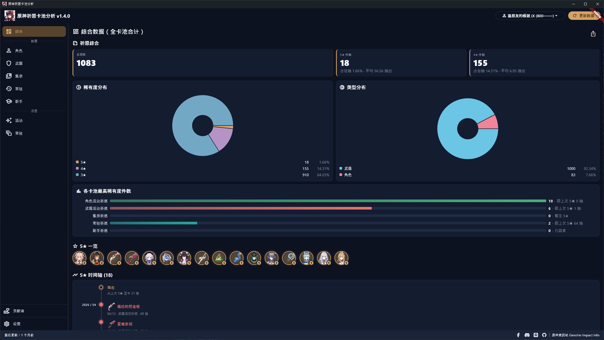
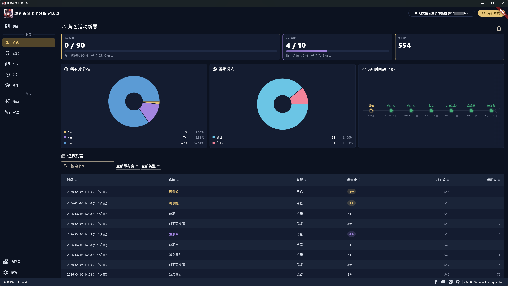
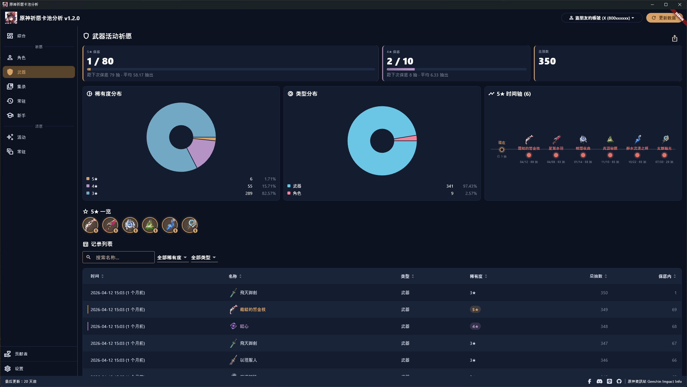
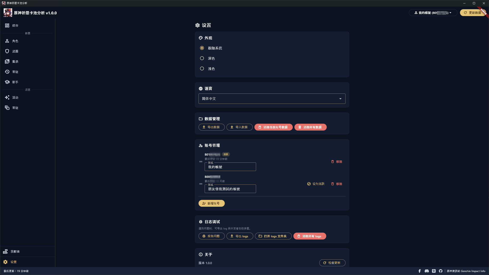
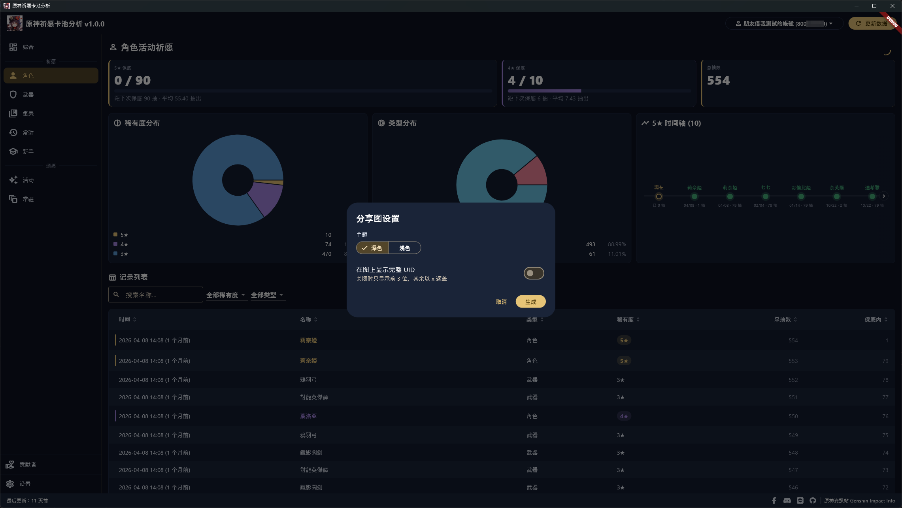
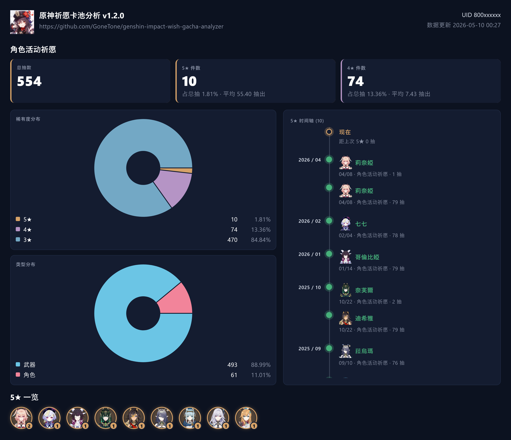
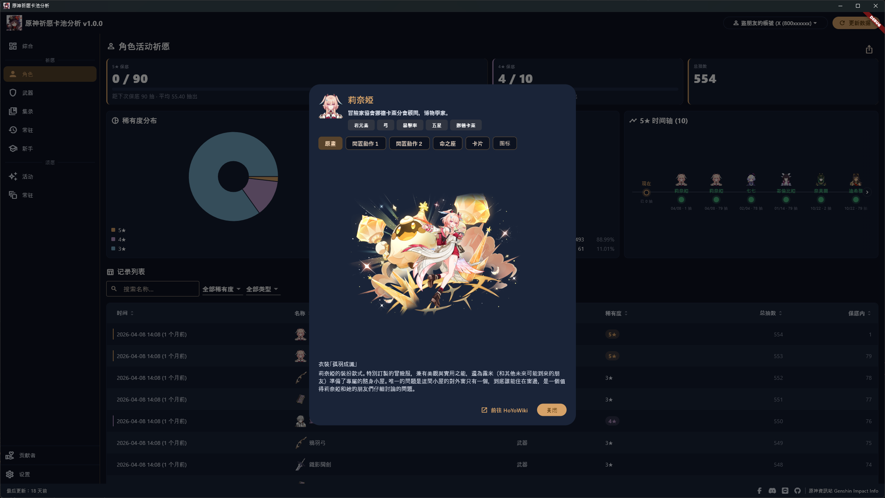

# 原神祈愿卡池分析 Genshin Impact Wish Gacha Analyzer

[繁體中文](README.md) | 简体中文 | [English](README_EN.md) | [日本語](README_JA-JP.md)

[](https://crowdin.com/project/genshin-impact-wish-gacha-analyzer)

一套用来分析祈愿卡池历史记录的软件，支持 Windows 与 Android，一打开各种数据清清楚楚，不用再手动计算啦！

Windows 版的原理是：按下「更新数据」后会在本机启动一个只跑在您电脑上的代理服务器，并自动安装一张本机生成的根证书，借此拦截原神 WebView 对 miHoYo 卡池历史 API 的请求，所以要在按下更新后再到游戏内打开卡池历史记录才能拦到，拿到网址后解析参数，参数会用于 miHoYo 原神相关的 API。

Android 版不拦截连接，改为读取系统 log，从中找出原神打开卡池历史页面时留下的网址。Android 不允许 App 直接读取其他 App 的系统 log，所以会根据设备情况使用 root 或系统内置的「无线调试」（Android 11 以上）来读取，两种都无法使用时可以改用手动输入祈愿记录网址。使用无线调试时读完就会断开连接，如果无线调试是本 App 打开的，也会一并关闭。

第一次按下「更新数据」会加载您完整的卡池历史，这可能需要一些时间，完成后会将数据保存在您的设备上，这样下次打开软件就不用再花时间等待数据加载。之后想获取新数据按一下「更新数据」即可，软件会记住先前获取的网址，能用就直接用、不用每次重新获取；如果网址过期，软件会请您再到游戏打开一次卡池历史页面以重新获取网址。

请放心：本软件不会篡改任何游戏文件，也不会读取或篡改游戏内存。Windows 版只会拦下 WebView 打开卡池历史页面时的那一条请求网址，以及从游戏的 log 找出游戏文件夹、从网页缓存找出网址；Android 版只会从系统 log 读取原神的祈愿记录网址。所以不会有账号被封禁的风险。如果您被封号，请思考是否因为其他原因被封禁，不要怪我们。

帖子：
- 巴哈姆特：<https://forum.gamer.com.tw/C.php?bsn=36730&snA=11990>
- HoYoLAB：<https://www.hoyolab.com/genshin/article/552176>
- 原神资讯站：<https://genshininfo.reh.tw/archives/97>

## 多国语言

请帮我们将软件翻译成各国语言！

<https://crowdin.com/project/genshin-impact-wish-gacha-analyzer>

## 下载软件

软件在安装或运行时有可能会被杀毒软件拦截。原因是本软件会自行生成并安装一张本机根证书，并在按下更新时短暂设置系统代理以拦截原神 WebView 的卡池历史请求——这类行为与恶意程序相似，但本软件只拦截 `*.hoyoverse.com` 上的 `getGachaLog`（祈愿）与 `getBeyondGachaLog`（颂愿）这两条卡池历史 API，且证书只留在您的电脑上。如果无法正常运行，请尝试关闭杀毒软件后再运行试试，本软件保证无毒。

<https://github.com/GoneTone/genshin-impact-wish-gacha-analyzer/releases>

### 也有支持其他游戏的版本

- 鸣潮：<https://github.com/GoneTone/wuthering-waves-convene-gacha-analyzer>
- 未来可能新增支持更多游戏...

## 使用方法

### Windows

1. 启动原神，先别打开卡池历史页面。
2. 打开本软件并按下「更新数据」，软件会在后台启动本机代理服务器并等候拦截。
3. 切回游戏，到「祈愿 → 历史记录」打开卡池历史页面。
4. 软件拦到网址后会自动关闭代理、还原系统代理设置并开始抓取数据；之后想再更新只要重复步骤 2，网址未过期就会直接使用。

### Android

1. 第一次按下「更新数据」时，有 root 的设备会直接用 root 读取；其他设备 App 会引导你设置系统内置的「无线调试」，按画面提示配对一次（需要 Android 11 以上、连上 Wi‑Fi、允许通知），之后 App 会自己开关无线调试（部分设备有额外的安全限制，可能需要每次手动开启）。
2. 按下「更新数据」后切到游戏，到「祈愿 → 历史记录」打开卡池历史页面。
3. App 从系统 log 找到网址后，回到 App 就会自动开始抓取数据。
4. 无法自动读取时（例如没有 root 且是 Android 10 及以下，或没有连上 Wi‑Fi），可以改用手动输入祈愿记录网址。

## 功能与特色

- 支持 Windows 与 Android
- 自动获取祈愿记录网址，无需手动粘贴网址：Windows 版拦截原神 WebView 对 miHoYo 卡池历史 API 的请求（通过本机代理服务器与自签根证书）；Android 版读取系统 log（root 或无线调试）
- 支持国际服（暂不支持国服）
- 涵盖 7 种卡池：角色活动祈愿、武器活动祈愿、集录祈愿、常驻祈愿、新手祈愿、活动颂愿、常驻颂愿
- 多账号 (UID) 管理：自定义别名、拖动排序、一键切换
- 自动合并新旧数据，不覆盖过往记录，不会因为官方历史记录过期而丢失
- 总抽数及 5★ / 4★ / 3★ / 2★ 数量与占比统计
- 5★ 与 4★ 双保底进度条（常驻颂愿为 4★ 与 3★），并显示距离保底的剩余抽数
- 5★ / 4★ 平均出货抽数统计（各卡池与整体；常驻颂愿为 4★ 与 3★）
- 各卡池 5★ 时间轴（常驻颂愿为 4★）
- 5★ 总览：横向陈列抽到过的所有不重复 5★，每个附累计次数徽章、可点开详情；各卡池页、综合数据页与分享图都会显示
- 各卡池最高稀有度数量对比柱状图
- 稀有度分布饼图
- 类型分布饼图
- 历史记录表格：多列排序、关键字搜索（按名称）、稀有度与物品类型筛选、分页
- 自动补上角色 / 武器的图标与资料（来源：[HoYoWiki](https://wiki.hoyolab.com/pc/genshin/home)）：表格与时间轴都附图标；点击物品可查看官方插画、描述与标签，并一键跳转 HoYoWiki
- 一键生成分享图（可选深色 / 浅色主题、UID 全显或只留前三码遮罩），可复制到剪贴板或另存为 PNG 文件，Android 版也能直接通过系统分享
- 账号数据导出 / 导入 JSON
- 云端同步：关联您自己的 Google 账号后，卡池记录自动备份到您的 Google 云端硬盘，并在多台设备间双向同步；删除账号时可勾选一并从云端移除
- 深色 / 浅色主题切换
- 多国语言（[协助翻译](https://crowdin.com/project/genshin-impact-wish-gacha-analyzer)）
- 可在设置开启界面 UID 遮罩（只显示前三码），保护隐私
- 启动时自动检查新版本，也可在设置页手动触发（Android 版通过 Google Play 更新）
- 所有数据默认留在本机、不上传；云端同步为可选功能，启用后也只会备份到您自己的 Google 云端硬盘
- Android 版会显示 AdMob 原生广告（需要同意的地区会先征求同意）；Windows 版没有广告

## 截图










## 开发

### 前置需求

- Windows 版要在 Windows 上构建；Android 版另需 [Android Studio](https://developer.android.com/studio)（Android SDK）
- [Flutter SDK](https://docs.flutter.dev/install)（最新稳定版）
- [Rust toolchain](https://rustup.rs/)（stable）
- 运行 `flutter doctor`，根据提示补齐缺少的工具

### 获取源代码并安装依赖

```bash
git clone https://github.com/GoneTone/genshin-impact-wish-gacha-analyzer.git
cd genshin-impact-wish-gacha-analyzer
flutter pub get
```

Rust 会在 `flutter run` / `flutter build` 时由 `rust_builder/` 的 cargokit 自动编译，无需手动 `cargo build`（但需先安装 Rust toolchain）。

### 开发模式运行

```bash
flutter run -d windows        # Windows
flutter run -d <设备 ID>      # Android 真机或模拟器（ID 用 flutter devices 查）
```

### 云端同步凭据（可选）

云端同步（Google 云端硬盘备份）需要 Google OAuth 凭据。未设置时其他功能完全不受影响，仅设置页的云端同步区块显示未设置提示。

要在自己的构建中启用：

1. 到 [Google Cloud Console](https://console.cloud.google.com/) 创建项目，启用 **Google Drive API**，配置 OAuth 同意屏幕（scopes：`.../auth/drive.appdata` 与 `email`），创建「**桌面应用**」类型的 OAuth 客户端。
2. 在项目根目录创建 `secrets/cloud_sync_defines.json`（已被 git 忽略）：

   ```json
   {
     "CLOUD_SYNC_CLIENT_ID": "你的 client id",
     "CLOUD_SYNC_CLIENT_SECRET": "你的 client secret"
   }
   ```

3. 运行时带入该文件（JetBrains IDE 可直接选内置的「main.dart (cloud sync + ads)」运行配置（会一并带入下方的 `secrets/ads_defines.json`，两个文件都要存在）；`build_release.ps1` 打包时会自动检测）：

   ```bash
   flutter run -d windows --dart-define-from-file=secrets/cloud_sync_defines.json
   ```

4. Android 沿用同一个 `secrets/cloud_sync_defines.json`，但要在**同一个** Google Cloud 项目再创建一个「**Android**」类型的 OAuth 客户端：软件包名称填 `tw.reh.genshin.gacha`，SHA-1 填签署 APK 那把密钥的指纹（开发用 debug 密钥可用 `keytool -list -v -keystore ~/.android/debug.keystore -alias androiddebugkey -storepass android` 查询）。这个客户端的 ID 不需要放进配置文件，Google 会用软件包名称和签名比对。必须和桌面版客户端在同一个项目，两边才会读写同一份同步文件。

   ```bash
   flutter run -d <设备 ID> --dart-define-from-file=secrets/cloud_sync_defines.json
   ```

### 广告 ID（选用，Android）

Android 原生广告的 AdMob ID 同样在构建时注入，不写进源代码。要在自己的构建投放正式广告，在项目根目录创建 `secrets/ads_defines.json`（已被 git 忽略），并和云端同步配置文件一起带入：

```json
{
  "ADMOB_APP_ID": "ca-app-pub-xxxxxxxxxxxxxxxx~yyyyyyyyyy",
  "ADMOB_NATIVE_UNIT_ID": "ca-app-pub-xxxxxxxxxxxxxxxx/wwwwwwwwww"
}
```

```bash
flutter run -d <设备 ID> --dart-define-from-file=secrets/cloud_sync_defines.json --dart-define-from-file=secrets/ads_defines.json
```

没有这个文件、或非 release 构建时，一律使用 Google 官方测试广告 ID，只会显示测试广告。


### Rust ↔ Dart 桥接代码生成

修改 `rust/src/api/` 内的 Rust 函数后，重新生成桥接代码。第一次使用前先安装 codegen 工具：

```bash
cargo install flutter_rust_bridge_codegen --version 2.12.0
```

之后每次修改 API 都运行：

```bash
flutter_rust_bridge_codegen generate
```

生成的文件位于 `lib/src/rust/`。

### 编译生产版

Windows：

```bash
flutter build windows --release
```

输出：`build\windows\x64\runner\Release\`

Android：

```bash
flutter build apk --release        # 直接安装用的 APK
flutter build appbundle --release  # 上传 Google Play 用的 AAB
```

输出：`build/app/outputs/flutter-apk/app-release.apk`、`build/app/outputs/bundle/release/app-release.aab`

要用自己的密钥签名，在 `android/key.properties`（已被 git 忽略）填入 `storeFile`、`storePassword`、`keyAlias`、`keyPassword`；没有这个文件时会用 debug 密钥签名。

### 运行测试

```bash
flutter test
cargo test --manifest-path rust/Cargo.toml
```
